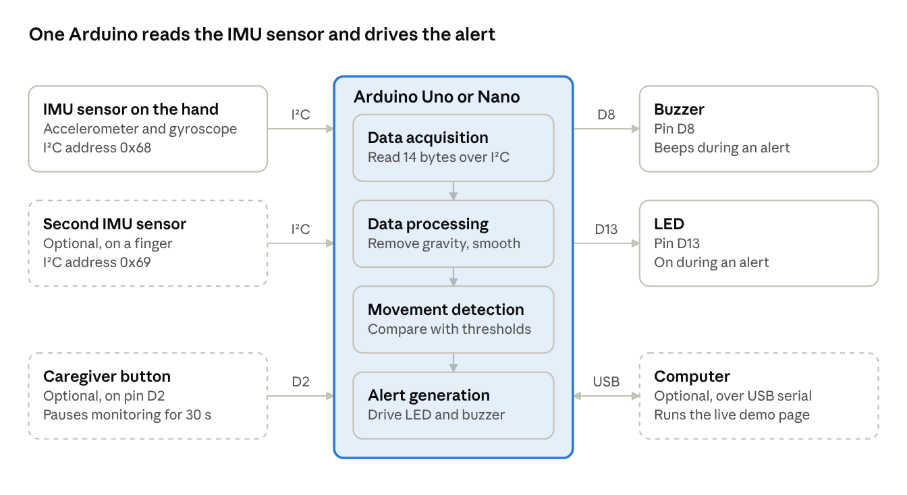
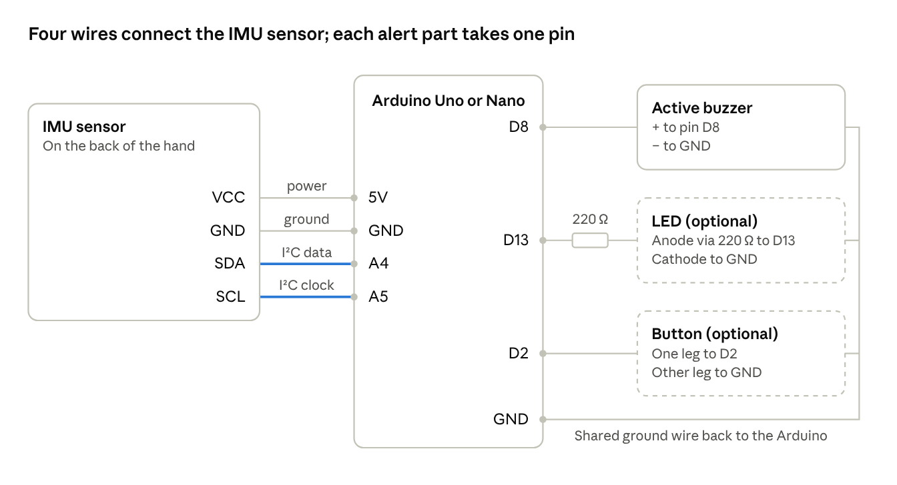
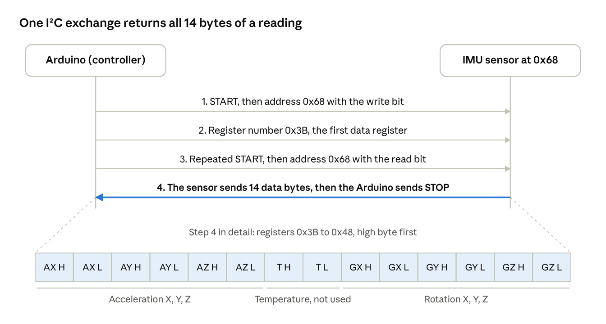
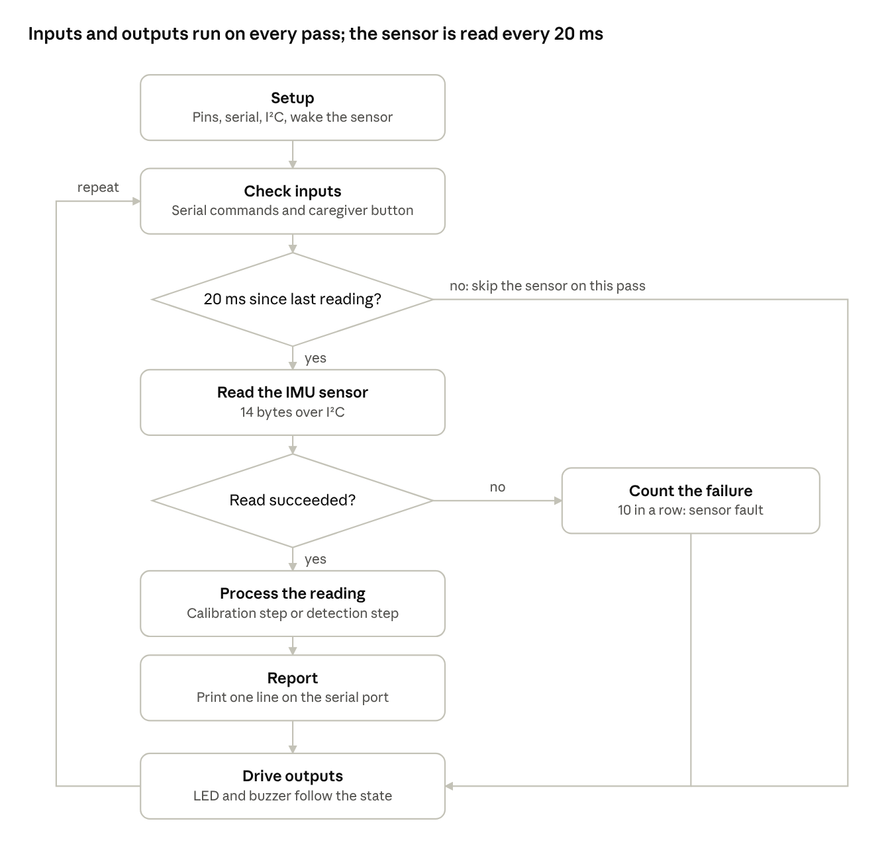
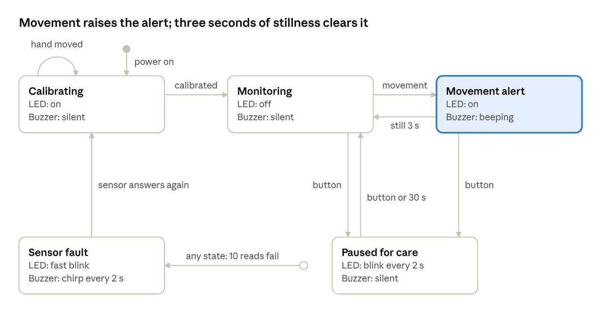
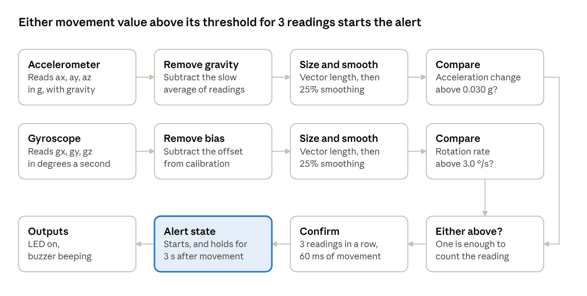

# Hand Mobility Assessment Glove: Technical Document

13 October 2026

## Contents

1. [Summary](#summary)
2. [Problem and objectives](#problem-and-objectives)
3. [System overview](#system-overview)
4. [Hardware design](#hardware-design)
5. [I²C communication](#i²c-communication)
6. [Firmware design](#firmware-design)
7. [Operating states](#operating-states)
8. [Movement detection algorithm](#movement-detection-algorithm)
9. [Detection settings](#detection-settings)
10. [Serial protocol](#serial-protocol)
11. [Live demo page](#live-demo-page)
12. [Testing and results](#testing-and-results)
13. [Limitations and safety](#limitations-and-safety)
14. [Future improvements](#future-improvements)
15. [Appendix](#appendix)

## Summary

The Hand Mobility Assessment Glove detects hand movement in a coma patient and alerts a caregiver with a buzzer and an LED. An Arduino reads an IMU sensor on the back of the hand 50 times a second over I²C and compares two movement values with thresholds.

The Arduino program compiles for the Uno and Nano, and its detection logic passes every simulated test. It has not yet been run on real hardware.

| Deliverable | File | Status |
| --- | --- | --- |
| Arduino program | [`firmware/HandMobilityGlove/HandMobilityGlove.ino`](../firmware/HandMobilityGlove/HandMobilityGlove.ino) | Compiles; not yet run on hardware |
| Live demo page | [`demo/index.html`](../demo/index.html) | Working in the browser |
| Project README | [`README.md`](../README.md) | Complete |

| Item | Value |
| --- | --- |
| Controller | Arduino Uno or Nano |
| Sensor | IMU sensor with a 3-axis accelerometer and a 3-axis gyroscope |
| Sensor link | I²C at 400 kHz, address 0x68 |
| Sample rate | 50 readings a second |
| Alert outputs | Buzzer on pin D8, LED on pin D13 |
| Default thresholds | 0.030 g acceleration change, 3.0 °/s rotation rate |
| Shortest detection time | 60 ms (3 readings in a row) |
| Program size | 12,018 bytes, 37% of an Arduino Uno |

## Problem and objectives

A coma patient may move a hand at any moment, and staff cannot watch every patient all the time. These movements can be involuntary, reflexive or spontaneous. A caregiver needs to know when one happens so that the patient can be assessed.

The glove watches the hand continuously and raises an alert when it moves. It reports that movement happened; it does not judge what the movement means.

### Objectives

- Detect hand movement in real time with a wearable IMU sensor.
- Read the IMU sensor from an Arduino over I²C.
- Separate real movement from normal sensor noise.
- Alert the caregiver automatically with sound and light.
- Let a caregiver pause the alert while attending the patient.
- Keep the design low-cost: one microcontroller and one sensor.
- Show the system working without hardware, through a live demo page.

### Out of scope

- Deciding whether a movement is voluntary, involuntary or a reflex.
- Judging the patient's level of consciousness or recovery.
- Clinical validation and medical safety approval.

## System overview

The system is one IMU sensor, one Arduino and two alert outputs. Everything else is optional.



*Figure 1. System block diagram: the Arduino and the six parts around it.*

Readings flow from left to right: the IMU sensor measures, the Arduino decides, and the buzzer and LED alert. Dashed boxes are optional parts.

The Arduino repeats five stages 50 times a second:

1. **Motion sensing.** The IMU sensor measures acceleration and rotation on three axes.
2. **Data acquisition.** The Arduino reads 14 bytes from the sensor over I²C.
3. **Data processing.** Gravity and bias are removed, and two movement values are worked out and smoothed.
4. **Movement detection.** Each value is compared with its threshold. Three readings in a row above a threshold confirm movement.
5. **Alert generation.** The LED turns on and the buzzer beeps until the hand has been still for 3 seconds.

## Hardware design

The required hardware is an Arduino, one IMU sensor and a buzzer, joined by six wires. An LED, a button and a second IMU sensor are optional.

### Parts

| Part | Role | Needed |
| --- | --- | --- |
| Arduino Uno or Nano | Runs the program, reads the sensor, drives the outputs | Required |
| IMU sensor | Measures acceleration and rotation of the hand | Required |
| Active buzzer, 5 V | Beeps during an alert | Required |
| Glove | Holds the IMU sensor on the back of the hand | Required |
| Jumper wires and USB cable | Connections, programming and power | Required |
| LED and 220 Ω resistor | A brighter alert light. The Arduino's on-board LED on pin 13 lights without it | Optional |
| Push button | Caregiver button: pauses monitoring for 30 seconds | Optional |
| Second IMU sensor | On a finger, to catch small finger movements | Optional |

### The IMU sensor

The IMU sensor is an MPU-6050 on a GY-521 breakout board. One chip holds a 3-axis accelerometer and a 3-axis gyroscope, so no separate sensors are needed. The program is written for this model; another IMU model would need different register settings.

| Property | Setting used |
| --- | --- |
| Accelerometer range | ±2 g, at 16,384 counts per g |
| Gyroscope range | ±250 °/s, at 131 counts per °/s |
| Output values | 16-bit signed numbers |
| Built-in low-pass filter | About 20 Hz |
| Readings | 50 a second |
| I²C address | 0x68, or 0x69 with the AD0 pin tied to 3.3 V |
| Supply | 5 V to the board's VCC pin; the board regulates it to 3.3 V |

Mounted as the demo page draws it, the sensor's X axis points across the hand, Y toward the fingers and Z out of the back of the hand. A resting hand then reads about +1 g on Z, which is gravity. Detection uses the size of the movement across all three axes, so the mounting direction does not change the result.

### Wiring



*Figure 2. Wiring diagram: IMU sensor, buzzer, LED and button on an Arduino Uno or Nano.*

The two highlighted wires are the I²C bus; the other two power the sensor. Every part's ground goes back to a GND pin on the Arduino. The [Appendix](#appendix) lists each connection as a table.

### Power

The Arduino is powered through its USB port, from a computer or a 5 V power bank. It supplies the IMU sensor, buzzer and LED from its own pins.

## I²C communication

The Arduino is the I²C controller and gets a complete reading in one 14-byte exchange every 20 ms.

I²C uses two wires. SDA carries the data and is on Arduino pin A4. SCL carries the clock and is on pin A5. The bus runs at 400 kHz. Each device has an address: the IMU sensor on the hand answers at 0x68, and an optional second one at 0x69.

### Start-up settings

At power-up the Arduino checks that the sensor answers, then writes five registers.

| Register | Value written | Purpose |
| --- | --- | --- |
| 0x75 WHO_AM_I | None, read only | Check that a sensor answers at this address |
| 0x6B PWR_MGMT_1 | 0x01 | Wake the sensor and use the gyroscope clock |
| 0x19 SMPLRT_DIV | 19 | 1 kHz ÷ (1 + 19) = 50 readings a second |
| 0x1A CONFIG | 0x04 | Built-in low-pass filter, about 20 Hz |
| 0x1B GYRO_CONFIG | 0x00 | Gyroscope range ±250 °/s |
| 0x1C ACCEL_CONFIG | 0x00 | Accelerometer range ±2 g |

### Reading the sensor



*Figure 3. I²C read sequence: four steps and the 14 bytes returned.*

Each value is two bytes, high byte first, read as a signed 16-bit number. The two temperature bytes arrive in the middle of the block and are skipped.

| Value | Conversion | Example |
| --- | --- | --- |
| Acceleration | counts ÷ 16,384 = g | Bytes 0x40 0x00 = 16,384 counts = 1.000 g |
| Rotation | counts ÷ 131 = °/s | Bytes 0x01 0x06 = 262 counts = 2.0 °/s |

### When the sensor does not answer

- A bus timeout of 3 ms stops a loose wire from freezing the program.
- A failed read is skipped; the previous reading is never reused.
- After 10 failed reads in a row the glove enters the sensor fault state.
- In that state it tries to wake the sensor once a second, and recalibrates when it answers.

## Firmware design

The program is one Arduino sketch of 480 lines that never waits. Inputs and outputs are handled on every pass of the loop, and the sensor is read every 20 ms.



*Figure 4. Main loop flowchart: seven steps and two decisions.*

Because nothing blocks, the caregiver button and the buzzer pattern stay responsive between sensor readings.

### Structure

| Group | Functions | Job |
| --- | --- | --- |
| I²C | `writeRegister` `readRegisters` `imuBegin` `imuRead` | Talk to the IMU sensor and convert its bytes to g and °/s |
| Calibration | `startCalibration` `calibrationStep` | Measure gyroscope bias and gravity with the hand still |
| Detection | `updateMotion` `detect` `caregiverButton` | Work out the movement values and change state |
| Faults | `enterFault` `recoverFromFault` | Handle a sensor that stops answering |
| Outputs | `setBuzzer` `driveOutputs` | Turn the state into LED and buzzer patterns |
| Serial | `printSample` `printSettings` `handleCommand` `pollSerial` | Send readings and accept commands |
| Scheduling | `pollButton` `sampleTick` `setup` `loop` | Debounce the button and run everything on time |

### Timing

- The loop compares `millis()` with the time of the last reading and takes a new one when 20 ms have passed.
- If the loop falls more than one period behind, it does not try to catch up. It restarts the 20 ms count from now.
- Sending one output line takes about 7 ms, so a full pass fits inside the period.
- The button is debounced: a press counts only after the pin has been steady for 40 ms.

### Dependencies and size

The sketch uses only the Wire library that ships with the Arduino software. On an Uno it takes 12,018 bytes of program memory and 728 bytes of RAM, about a third of each.

## Operating states

The glove is always in one of five states, and the LED and buzzer show which one.



*Figure 5. State diagram: five states and what moves the glove between them.*

Movement confirmed in the monitoring state raises the alert. The alert clears by itself once the hand has been still for the hold time, 3 seconds by default.

| State | Serial code | LED | Buzzer |
| --- | --- | --- | --- |
| Monitoring | 0 | Off | Silent |
| Movement alert | 1 | On | 200 ms on, 200 ms off |
| Paused for care | 2 | 100 ms flash every 2 s | Silent |
| Calibrating | 3 | On | Silent |
| Sensor fault | 4 | 100 ms on, 100 ms off | 100 ms chirp every 2 s |

At power-up the buzzer also gives one 120 ms beep, so a dead buzzer is noticed straight away.

### Calibration

Calibration takes 100 readings, which is 2 seconds, with the hand still. The average gyroscope reading becomes the bias to subtract, and the average accelerometer reading becomes the first gravity estimate. If any gyroscope axis varies by more than 4 °/s during those readings, the hand moved and calibration starts again.

### The caregiver button

One press silences an alert and pauses monitoring, so that touching the patient does not set the alarm off. Monitoring resumes after 30 seconds, or at once on a second press. Movement during the pause is ignored and not counted.

## Movement detection algorithm

Movement is confirmed when either of two values stays above its threshold for 3 readings in a row. The acceleration change comes from the accelerometer, and the rotation rate comes from the gyroscope.



*Figure 6. Detection pipeline: two sensor lanes and one decision lane.*

The top lane handles shaking and shifting, the middle lane handles turning, and the bottom lane makes the decision.

### Acceleration change

The accelerometer always feels gravity, about 1 g, even when the hand is still. The program keeps a slow-moving estimate of gravity and measures how far each reading is from it.

$$
c = \lVert \mathbf{a} - \mathbf{g}_{est} \rVert \qquad \mathbf{g}_{est} \leftarrow \mathbf{g}_{est} + 0.04\,(\mathbf{a} - \mathbf{g}_{est})
$$

Here `a` is the reading in g and `g_est` is the gravity estimate, which moves 4% of the way toward each new reading. It catches up with a new tilt in about half a second. A hand that is tilted but still therefore reads zero, and only real movement stands out.

### Rotation rate

The gyroscope reads zero when the hand is still, once its bias is removed. The rotation rate is the size of the reading across the three axes.

$$
r = \sqrt{g_x^2 + g_y^2 + g_z^2}
$$

### Smoothing

Both values are smoothed so that a single noisy reading cannot cross a threshold. Each smoothed value moves 25% of the way toward its new reading, which gives a response time of about 70 ms.

$$
m \leftarrow m + 0.25\,(x - m)
$$

### Decision

1. A reading counts if the smoothed acceleration change is above 0.030 g, or the smoothed rotation rate is above 3.0 °/s.
2. A counter adds one for each reading that counts, and returns to zero on the first that does not.
3. When the counter reaches 3, movement is confirmed and the alert starts.
4. Every further confirmed reading restarts the hold timer.
5. The alert ends when the hold time, 3 seconds, passes with no confirmed movement.

### Why two sensors

Each sensor catches movement the other misses. A straight knock has almost no rotation, so only the accelerometer sees it. A gentle turn has almost no acceleration, so only the gyroscope sees it. With a second IMU sensor fitted, the larger value from the two sensors is used.

### Worked example

In simulation a finger twitch lasts about a quarter of a second. Its smoothed values peak at 0.045 g and 6.9 °/s, both above their thresholds. Movement is confirmed 120 ms after the twitch begins, and the alert stays on for 3 seconds after it ends.

## Detection settings

Five settings control how sensitive the glove is and how the alert behaves. In simulation the resting values peak at 0.009 g and 0.18 °/s, so the default thresholds sit about 3.5 and 17 times above sensor noise.

| Setting | Variable in the sketch | Default | Range by serial command | What it controls |
| --- | --- | --- | --- | --- |
| Acceleration-change threshold | `accelThresholdG` | 0.030 g | 0.005 to 1.0 g | How big a shake or shift counts as movement |
| Rotation threshold | `gyroThresholdDps` | 3.0 °/s | 0.5 to 100 °/s | How fast a turn counts as movement |
| Readings in a row to confirm | `confirmSamples` | 3 (60 ms) | 1 to 50 | How long movement must last before the alert starts |
| Alert hold time | `alertHoldMs` | 3,000 ms | 500 to 60,000 ms | How long the alert stays on after the hand is still |
| Care pause | `carePauseMs` | 30,000 ms | 1,000 to 600,000 ms | How long the caregiver button pauses monitoring |

### The trade-off

A lower threshold catches smaller movements but lets sensor noise set off the alarm. A higher threshold stops false alarms but misses small movements. The simulated faint finger flex peaks at about 1.3 °/s, so it is missed at 3.0 °/s and caught at 1.0 °/s.

### Tuning on a real glove

1. Fix the IMU sensor to the glove and connect the demo page over USB.
2. Keep the hand still for one minute. Note the highest resting value on each of the two lower charts.
3. Set each threshold to about three times its resting peak.
4. Make the smallest movement the glove should catch. Lower the thresholds until it is detected every time.
5. If false alerts appear, first raise the readings in a row to confirm, then the thresholds.
6. Copy the four lines the page shows into the sketch and upload it again.

## Serial protocol

The Arduino sends one text line per reading at 115200 baud and accepts single-letter commands. The Arduino Serial Plotter and the demo page both read the same line format.

### Output line

```text
ax:0.012,ay:-0.004,az:1.002,gx:0.10,gy:-0.20,gz:0.00,am:0.004,gm:0.21,st:0
```

| Field | Meaning | Unit |
| --- | --- | --- |
| `ax` `ay` `az` | Acceleration on each axis | g |
| `gx` `gy` `gz` | Rotation on each axis, bias removed | °/s |
| `am` | Acceleration change, the first movement value | g |
| `gm` | Rotation rate, the second movement value | °/s |
| `st` | State: 0 monitoring, 1 alert, 2 paused, 3 calibrating, 4 sensor fault | none |

The axis fields come from the IMU sensor on the hand. When a second IMU sensor is fitted, `am` and `gm` are the larger of the two sensors' values.

Lines that start with `#` are messages for a person to read, such as `# ready` or `# movement event 3`. One line takes about 7 ms to send, which fits inside the 20 ms between readings.

### Commands

Each command is one line: a letter, then a number where one is needed.

| Command | Example | Effect |
| --- | --- | --- |
| `A` | `A0.030` | Set the acceleration-change threshold, in g |
| `G` | `G3.0` | Set the rotation threshold, in °/s |
| `C` | `C3` | Set the readings in a row needed to confirm movement |
| `H` | `H3000` | Set the alert hold time, in ms |
| `P` | `P30000` | Set the care pause, in ms |
| `K` | `K` | Same as pressing the caregiver button |
| `R` | `R` | Recalibrate |
| `?` | `?` | Print the current settings |

Settings changed by command last until the Arduino is reset. To keep them, change the values in the sketch and upload it again.

## Live demo page

The demo page is a single HTML file that simulates the glove in a browser and can also show a real glove over USB. It needs no installation: open [`demo/index.html`](../demo/index.html).

| Area of the page | What it shows |
| --- | --- |
| The glove | A hand that can be dragged to tilt it, and six movements to play |
| The alarm | The current state, LED, buzzer, event count and the caregiver button |
| Signal chain | The five system stages with live values, including the 14 I²C bytes |
| Live traces | Four charts: raw accelerometer, raw gyroscope, and the two movement values against their thresholds |
| Detection settings | Sliders for the thresholds and timing, with the matching lines for the sketch |
| Movement log | Each detected event: time, duration, peak values and which sensor tripped it |

### How the simulation works

The page runs the same detection steps as the Arduino program, with the same constants. Only the sensor is simulated.

1. The hand has a pose: roll, pitch and position. Dragging the hand or playing a movement changes it.
2. Rotation rate is how much the pose changed since the last reading. Linear acceleration is how much that change itself changed.
3. Gravity is added along whichever way the tilted sensor now faces.
4. Random noise is added: 0.003 g on each accelerometer axis and 0.06 °/s on each gyroscope axis. The gyroscope also gets a fixed offset, which calibration removes.
5. The values are rounded to the 16-bit counts a real IMU sensor sends, then packed into 14 bytes.
6. The detection steps run on those bytes exactly as they do on the Arduino.

The noise figures are typical values chosen for the simulation. They are not measurements of a real sensor.

### The six movements

| Movement | What it models |
| --- | --- |
| Finger twitch | A small, quick finger movement that slightly rocks the hand |
| Faint finger flex | A very small finger movement, below the default thresholds |
| Tremor | Shaking 5 times a second for 2.5 seconds |
| Wrist turn | The wrist rotating 28° and returning |
| Hand lift | The hand tilting up 14° and rising 3 cm, then lowering |
| Bed bump | A knock from outside: a sharp jolt with almost no rotation |

### Showing a real glove

1. Open `demo/index.html` in Chrome or Edge on a computer.
2. Close the Arduino Serial Monitor, because only one program can use the port.
3. Press **Arduino over USB** and choose the Arduino's port.

The page then plots the real readings, tilts the drawn hand to match the glove, and sends slider changes to the Arduino as commands. This link has not yet been tested with a real board.

## Testing and results

The program compiles and the detection logic passes every simulated test, but nothing has been tested on real hardware yet. The thresholds are therefore starting values.

### Build

The sketch was compiled with the Arduino AVR core 1.8.8 with all compiler warnings on. None came from the sketch.

| Board | Program memory | RAM for global variables |
| --- | --- | --- |
| Arduino Uno | 12,018 of 32,256 bytes (37%) | 728 of 2,048 bytes (35%) |
| Arduino Nano | 12,018 of 30,720 bytes (39%) | 728 of 2,048 bytes (35%) |

### Simulated movements

Each movement was played 40 times at the default settings, each time with different random sensor noise. Peaks are the highest seen across the 40 runs. Delay is the average time from the start of the movement to the alert.

| Movement | Runs detected | Peak acceleration change (g) | Peak rotation rate (°/s) | Delay to alert (ms) | Tripped by |
| --- | --- | --- | --- | --- | --- |
| Finger twitch | 40 of 40 | 0.045 | 6.9 | 120 | Both sensors |
| Faint finger flex | 0 of 40 | 0.011 | 1.3 | none | Neither |
| Tremor | 40 of 40 | 0.045 | 8.9 | 280 | Both sensors |
| Wrist turn | 40 of 40 | 0.307 | 80.2 | 140 | Both sensors |
| Hand lift | 40 of 40 | 0.168 | 40.1 | 160 | Both sensors |
| Bed bump | 40 of 40 | 0.087 | 0.5 | 80 | Accelerometer |

The default thresholds are 0.030 g and 3.0 °/s. The bed bump shows why both sensors are used: it barely rotates the hand, so only the accelerometer catches it.

### Other simulated checks

| Test | Result |
| --- | --- |
| Still hand, 40 runs of 60 s | No false alerts. Resting values peaked at 0.009 g and 0.18 °/s |
| Faint finger flex with the rotation threshold lowered to 1.0 °/s | Detected in 40 of 40 runs, with no false alerts in 40 still runs of 60 s |
| Acceleration threshold lowered to 0.005 g, still hand | 10 false alerts across 10 runs of 30 s |
| Sensor noise raised to 8 times typical, default thresholds | 10 false alerts across 10 runs of 30 s |
| Hand tilted 30° and held there | One alert during the tilt, then back to monitoring while still tilted |
| Movement during a care pause | Ignored |
| Movement after resuming with the button | Detected |
| Care pause left to run out | Monitoring resumed and the next movement was detected |
| Calibration with a still hand | Finished in 2.0 s |
| Hand moved during calibration | Calibration restarted and finished at 4.0 s |

### Demo page

The page was loaded in a headless browser at widths of 1280 px and 400 px. There were no script errors and no sideways scrolling. Alerts, the care pause, chart tooltips and dragging the hand all worked.

### Not yet tested

- The program running on a real Arduino with a real IMU sensor.
- The thresholds against real sensor noise and real hand movements.
- The USB link between the demo page and a real board.
- A second IMU sensor on a finger.
- Long continuous running, battery power, and use on a person.

## Limitations and safety

The glove is a student prototype that detects motion. It is not a medical device and must not be relied on for patient care.

| Limitation | Why | What helps |
| --- | --- | --- |
| It cannot tell why the hand moved | An IMU sensor measures motion only | A caregiver assesses the patient after every alert |
| Small finger movements can be missed | One sensor on the back of the hand feels a finger only faintly | A second IMU sensor on a finger, or lower thresholds |
| Outside movement trips the alert | A bumped bed or a nurse moving the arm shakes the sensor in the same way | The caregiver button pauses monitoring during care |
| Very slow movement can be missed | A turn slower than the rotation threshold also stays under the acceleration threshold | A lower rotation threshold |
| Alerts are local only | The buzzer and LED are at the bedside | A wireless link to a nurse station |
| Events are not stored | The Arduino keeps only a count of events | Logging the serial output on a computer |

### Hardware cautions

- A loose glove lets the sensor shift, which reads as movement. Fix the sensor firmly.
- If the IMU sensor stops answering, the glove cannot detect anything. The sensor fault state shows this with a fast-blinking LED and a chirp.
- An Arduino output pin supplies only a small current. Check the buzzer's rated current before wiring it straight to pin D8. A larger buzzer needs a transistor.
- Wires worn by a patient must be insulated, secured and kept clear of other medical equipment.

Real clinical use would need controlled testing, validated detection accuracy, proper alarm handling and a medical safety evaluation.

## Future improvements

The first step is to build the glove and tune the thresholds on real hardware. The rest extend what it can do.

1. Build and test on real hardware, and replace the simulated results with measured ones.
2. Add IMU sensors on the fingers to catch small finger movements.
3. Report the hand's orientation, as roll and pitch angles, from the Arduino as well as movement.
4. Send alerts wirelessly to a nurse station or a phone.
5. Log every event with its time to a memory card.
6. Run from a battery, with a low-battery warning.
7. Add a reference sensor on the bed frame to tell a bumped bed from a moving hand.
8. Save tuned settings in the Arduino's permanent memory so that they survive a reset.

## Appendix

### Pin connections

| Part | Pin on the part | Arduino pin |
| --- | --- | --- |
| IMU sensor | VCC | 5V |
| IMU sensor | GND | GND |
| IMU sensor | SDA | A4 |
| IMU sensor | SCL | A5 |
| Buzzer | + | D8 |
| Buzzer | − | GND |
| LED (optional) | Anode, through a 220 Ω resistor | D13 |
| LED (optional) | Cathode | GND |
| Caregiver button (optional) | One leg | D2 |
| Caregiver button (optional) | Other leg | GND |
| Second IMU sensor (optional) | VCC, GND, SDA, SCL | Same four pins as the first |
| Second IMU sensor (optional) | AD0 | 3.3V, which gives it address 0x69 |

### Constants in the sketch

| Constant | Value | Meaning |
| --- | --- | --- |
| `SAMPLE_PERIOD_MS` | 20 | Time between readings, which gives 50 readings a second |
| `GRAVITY_ALPHA` | 0.04 | Share of each new reading blended into the gravity estimate |
| `SMOOTH_ALPHA` | 0.25 | Share of each new value blended into the smoothed movement values |
| `CALIBRATION_SAMPLES` | 100 | Readings averaged during calibration, which takes 2 s |
| `CALIBRATION_MAX_SPREAD_DPS` | 4.0 | Gyroscope spread, in °/s, above which calibration restarts |
| `MAX_READ_ERRORS` | 10 | Failed reads in a row before a sensor fault |
| `ACCEL_LSB_PER_G` | 16,384 | Accelerometer counts per g |
| `GYRO_LSB_PER_DPS` | 131 | Gyroscope counts per °/s |
| `BUZZER_IS_PASSIVE` | 0 | Set to 1 for a passive piezo buzzer |
| `BUZZER_TONE_HZ` | 2,000 | Tone used for a passive buzzer |

### Project files

| File | Size | Contents |
| --- | --- | --- |
| `firmware/HandMobilityGlove/HandMobilityGlove.ino` | 480 lines, 21 functions | The Arduino program. Needs only the built-in Wire library |
| `demo/index.html` | 1,421 lines | The live demo page, in one file |
| `README.md` | 18 KB | Wiring, upload steps and usage |
| `docs/TECHNICAL_DOCUMENT.md` | This document | Design, diagrams, testing and limitations |
| `docs/images/` | 6 PNG files | The diagrams used in this document |

### Terms

| Term | Meaning |
| --- | --- |
| IMU | Inertial Measurement Unit: a sensor that measures movement and turning |
| Accelerometer | The part of the IMU that measures acceleration, including gravity |
| Gyroscope | The part of the IMU that measures how fast it is turning |
| I²C | Inter-Integrated Circuit: a two-wire link between a controller and its sensors |
| SDA, SCL | The two I²C wires: data and clock |
| g | The acceleration of gravity, about 9.81 m/s² |
| °/s | Degrees per second, the unit of rotation rate |
| Threshold | The limit a movement value must pass to count as movement |
